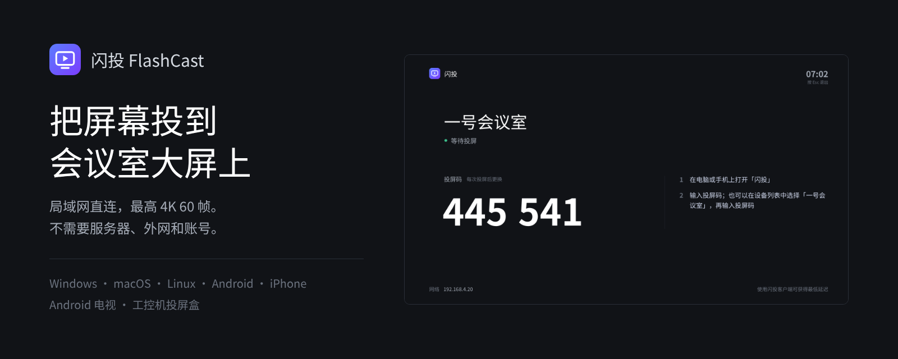
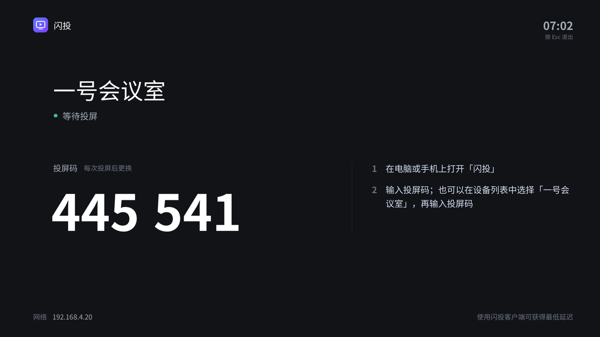
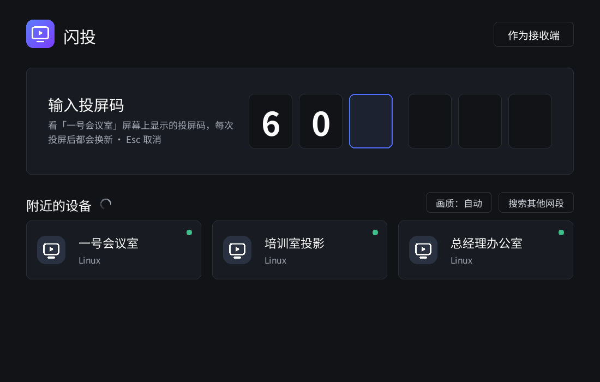
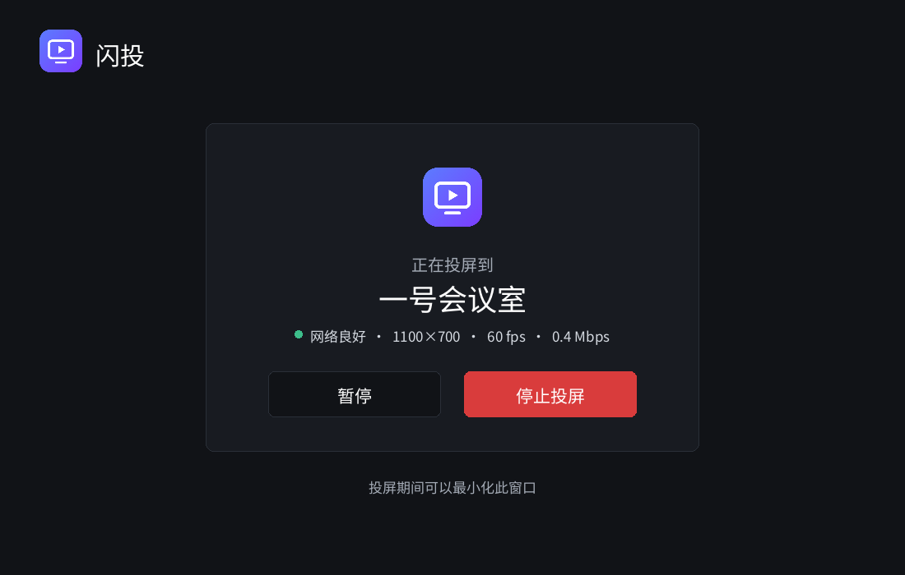

<p align="center">
  
</p>

<p align="center">
  <a href="https://github.com/wuha-like-sleep/flashcast-download/releases/latest"></a>
  
  
</p>

<p align="center">
  <b>把电脑屏幕投到电视、投影仪或另一台电脑上。</b><br>
  同一个局域网就能用，不需要服务器，不需要外网，不需要注册账号。
</p>

---

## ✨ 特点

<table>
  <tr>
    <td width="50%" valign="top">
      <h3>⚡ 低延迟</h3>
      自研传输协议，配合显卡硬件编码。前向纠错抵抗 Wi-Fi 丢包，不重传、不卡顿。演示 PPT、播放视频、操作软件都跟手。
    </td>
    <td width="50%" valign="top">
      <h3>🔒 完全本地</h3>
      画面只在你的局域网里传输，不经过任何服务器。断开外网也照常使用，适合对保密有要求的会议室和车间。
    </td>
  </tr>
  <tr>
    <td valign="top">
      <h3>🏢 多屏会议室</h3>
      每块屏幕显示自己的 6 位投屏码，输入哪块的码就投到哪块。多台电脑可以同时各投各的、互不干扰；屏幕正在使用时，别人投不进来。投屏设备可以单独放一个网段，不影响办公网络。
    </td>
    <td valign="top">
      <h3>📦 开箱即用</h3>
      安装包已经内置所有组件，下载即可使用，运行时不联网下载任何东西。界面支持简体中文、繁體中文、English、日本語和한국어。
    </td>
  </tr>
</table>

## 📥 下载

闪投分两部分：**接收端**装在显示画面的设备上，**发送端**装在要把画面投出去的设备上。点文件名即可下载，所有版本见 **[Releases 页面](https://github.com/wuha-like-sleep/flashcast-download/releases/latest)**。

### 📺 接收端 · 装在电视、会议室大屏、展厅屏幕上

| 设备 | 下载 | 说明 |
|:--|:--|:--|
|  **Windows 电脑** | [安装程序（.exe）](https://github.com/wuha-like-sleep/flashcast-download/releases/download/v0.1.0/FlashCast-Receiver-Setup-0.1.0-windows-x64.exe) · [免安装版（.zip）](https://github.com/wuha-like-sleep/flashcast-download/releases/download/v0.1.0/FlashCast-Receiver-0.1.0-windows-x64.zip) | 会议室、展厅的显示电脑；可选开机自动启动，自动设置防火墙 · **[安装说明](INSTALL-WINDOWS.md)** |
|  **Android 电视 / 电视盒子** | [电视版（.apk）](https://github.com/wuha-like-sleep/flashcast-download/releases/download/v0.1.0/FlashCast-TV-0.1.0-androidtv.apk) | 用 U 盘或电视助手安装 |
|  **工控机 / 迷你主机** | [系统镜像（.img.xz）](https://github.com/wuha-like-sleep/flashcast-download/releases/download/v0.1.0/FlashCast-Box-0.1.0-amd64.img.xz) | 写入工控机硬盘，开机即是接收端 · **[安装说明和硬件要求](INSTALL-BOX.md)** |
|  **Mac** ·  **Linux** | 用下方的电脑版 | 打开后点右上角 **作为接收端** |

### 💻 发送端 · 装在要投屏的电脑和手机上

| 设备 | 下载 | 说明 |
|:--|:--|:--|
|  **Windows** 10 / 11 | [电脑版（.zip）](https://github.com/wuha-like-sleep/flashcast-download/releases/download/v0.1.0/FlashCast-0.1.0-windows-x64.zip) | 解压后双击 `FlashCast.exe`（也可以当接收端） |
|  **Mac**（Apple 芯片：M1/M2/M3/M4） | [电脑版（.dmg）](https://github.com/wuha-like-sleep/flashcast-download/releases/download/v0.1.0/FlashCast-0.1.0-macos-arm64.dmg) | 打开后拖进"应用程序"；第一次打开见[常见问题](#-常见问题) |
|  **Mac**（Intel 芯片） | [电脑版（.dmg）](https://github.com/wuha-like-sleep/flashcast-download/releases/download/v0.1.0/FlashCast-0.1.0-macos-x86_64.dmg) | 同上 |
|  **Ubuntu / Debian** | [安装包（.deb）](https://github.com/wuha-like-sleep/flashcast-download/releases/download/v0.1.0/flashcast_0.1.0_amd64.deb) | `sudo apt install ./flashcast_0.1.0_amd64.deb` |
|  **其他 Linux** | [压缩包（.tar.gz）](https://github.com/wuha-like-sleep/flashcast-download/releases/download/v0.1.0/flashcast-0.1.0-linux-amd64.tar.gz) | 解压后运行 `bin/flashcast` |
|  **Android 手机** | [手机版（.apk）](https://github.com/wuha-like-sleep/flashcast-download/releases/download/v0.1.0/FlashCast-0.1.0-android.apk) | Android 8.0 及以上 |
|  **iPhone / iPad** | App Store 搜索 **Flash Cast** | 审核中，即将上架 |

> 不知道 Mac 是哪种芯片？点屏幕左上角  → **关于本机**，"芯片"一栏写 Apple M… 就是 Apple 芯片，写 Intel 就是 Intel 芯片。

## 🚀 三步开始投屏

<table>
  <tr>
    <td width="50%" align="center"></td>
    <td width="50%" align="center"></td>
  </tr>
  <tr>
    <td valign="top"><b>① 打开接收端</b><br>在电视或大屏连接的电脑上打开闪投，点 <b>作为接收端</b>。屏幕上会显示设备名和投屏码。</td>
    <td valign="top"><b>② 选择设备</b><br>在你的电脑上打开闪投，点击 <b>附近的设备</b> 里的那块屏幕，或者直接输入它的投屏码。</td>
  </tr>
</table>

<p align="center">
  <br>
  <b>③ 开始投屏</b>：画面马上出现在大屏上。点 <b>停止投屏</b> 即可结束。
</p>

## ❓ 常见问题

<details>
<summary><b>macOS 提示"无法验证…是否包含恶意软件"</b></summary>
<br>

1. 在提示框里点 <b>完成</b>（不要移到废纸篓）。
2. 打开 <b>系统设置 → 隐私与安全性</b>，向下滚动，在"已阻止使用 FlashCast"旁边点 <b>仍要打开</b>，输入电脑密码确认。
3. 以后就可以正常双击打开了。

（macOS 14 及更早版本也可以：右键点击 FlashCast → 打开 → 再点一次打开。）

**也可以用终端一步解决**：先把 FlashCast 拖进"应用程序"文件夹，然后打开"终端"，粘贴下面这行命令，按回车并输入电脑密码（输入时不显示）：

```bash
sudo xattr -rd com.apple.quarantine /Applications/FlashCast.app
```

之后双击即可正常打开。
</details>

<details>
<summary><b>macOS 投屏时提示没有屏幕录制权限</b></summary>
<br>
打开 <b>系统设置 → 隐私与安全性 → 屏幕录制</b>，允许 FlashCast，然后重新打开闪投。
</details>

<details>
<summary><b>找不到接收端</b></summary>
<br>

- 确认两台设备连的是同一个网络（同一个 Wi-Fi 或同一台路由器）。
- Windows 第一次运行时如果防火墙询问，请允许 **专用网络** 访问。
- 部分公共 Wi-Fi 开启了"客户端隔离"，设备之间无法直接通信，可以换个网络，或者直接输入投屏码再试一次。
- 接收端在另一个网段时（例如电脑是 192.168.3.x、大屏是 192.168.4.x），设备列表里看不到它，直接输入投屏码即可；也可以在“附近的设备”右侧点 **搜索其他网段** 把大屏所在的网段加进去。
</details>

<details>
<summary><b>投屏设备能和办公网络分开吗？</b></summary>
<br>

可以。把大屏、会议室电脑放到单独的网段或 VLAN（例如 192.168.4.x），办公电脑和手机留在原来的网段（例如 192.168.3.x）：

- 输入大屏上的 **6 位投屏码** 就能直接连上，不需要服务器；
- 两个网段差别较大时（例如 192.168.3.x 和 10.10.4.x），输入大屏左下角显示的 **IP 地址**，再输入它的投屏码；或者在 **搜索其他网段** 里填上 `10.10.4.0/24`。
- 防火墙只需要放行办公网到投屏网的 **TCP/UDP 47800–47809** 端口。

画面只在发送端和那块屏幕之间点对点传输，不会广播到网络里的其他电脑。
</details>

<details>
<summary><b>怎么暂停或断开投屏？</b></summary>
<br>

- **暂停**：发送端点“暂停”，大屏会停在当前画面（这时你可以切换窗口、查资料，大屏上看不到），点“继续”恢复。
- **在发送端结束**：点“停止投屏”。
- **在大屏这边断开**：按键盘 **Esc**，或者移动鼠标后点右上角的“断开投屏”；Android 电视上连按两次遥控器 **返回键**。
</details>

<details>
<summary><b>画面卡顿或延迟高</b></summary>
<br>

- 接收端尽量使用有线网络。
- 使用 5GHz Wi-Fi，并让发送端离路由器近一些。
- 发送端电脑有独立显卡或较新的核显时，会自动使用硬件编码，延迟更低。
</details>

<details>
<summary><b>需要联网或注册账号吗？</b></summary>
<br>
不需要。闪投只在局域网内工作，不连接任何服务器，也不收集任何数据。
</details>

## 🛟 帮助与隐私

- 遇到问题请联系：**[info@by-wave.com](mailto:info@by-wave.com)**
- 也可以在这里[提交 Issue](https://github.com/wuha-like-sleep/flashcast-download/issues)
- [隐私政策](PRIVACY.md)：不收集任何数据，画面只在局域网内传输

## 💻 系统要求

| | 最低要求 |
|:--|:--|
| Windows | Windows 10 64 位 |
| macOS | macOS 12.3 Monterey |
| Linux | glibc 2.35 以上（Ubuntu 22.04、Debian 12 及更新版本），X11 桌面 |
| Android | Android 8.0 及以上 |
| 网络 | 两台设备在同一局域网；推荐 5GHz Wi-Fi 或有线网络 |

---

<p align="center">
  <br>
  <sub>闪投 FlashCast · 闭源软件，可免费下载使用 · 第三方组件许可见安装包内的 <code>THIRD_PARTY_NOTICES.md</code></sub>
</p>
