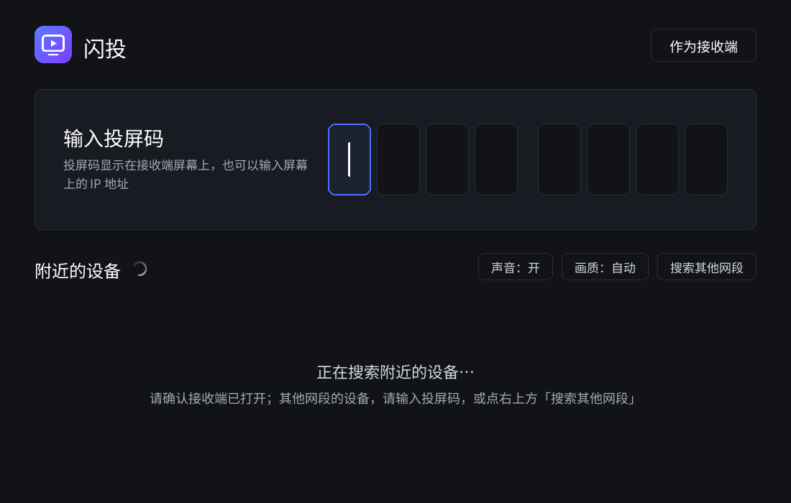

  

<h1 align="center">闪投 FlashCast</h1>

<strong>把画面和声音，带到大屏上。</strong>

  局域网直连 &nbsp; / &nbsp; 端到端加密 &nbsp; / &nbsp; 无需注册账号

  <a href="#下载"><strong>下载 0.4.4</strong></a>
  &nbsp; · &nbsp; <a href="#开始投屏">开始投屏</a>
  &nbsp; · &nbsp; <a href="#安装与更新">安装与更新</a>
  &nbsp; · &nbsp; <a href="#常见问题">常见问题</a>

 

  

<table>
  <tr>
    <td width="33%" valign="top"><strong>画面与声音同步</strong>  支持最高 4K / 60 帧，按设备与网络能力调整。可设置画质、分辨率和帧率上限。</td>
    <td width="33%" valign="top"><strong>一台电脑，两块屏幕</strong>  接收电脑可开启双屏同步，共用解码和声音输出。多路投屏各自保持独立会话。</td>
    <td width="33%" valign="top"><strong>内容留在本地</strong>  投屏不经过云端。随机投屏码完成配对，画面、声音和控制消息端到端加密。</td>
  </tr>
</table>

## 下载

**当前版本 0.4.4** · [全部文件](https://github.com/wuha-like-sleep/flashcast-download/releases/tag/v0.4.4) · [SHA-256 校验](https://github.com/wuha-like-sleep/flashcast-download/releases/download/v0.4.4/SHA256SUMS.txt)

> **0.4.4 与 0.4.3 兼容。** 建议两端都更新以获得完整优化；从更早版本升级时，请同时更新发送端和接收端。iPhone / iPad 的可用版本以 TestFlight 页面为准。

### 接收端

安装在**显示画面**的设备上：电视、会议室电脑、投影所连的电脑或专用投屏盒。

| 设备 | 下载 | 选择建议 |
| :-- | :-- | :-- |
| **Windows** | [安装程序](https://github.com/wuha-like-sleep/flashcast-download/releases/download/v0.4.4/FlashCast-Receiver-Setup-0.4.4-windows-x64.exe) · [免安装版](https://github.com/wuha-like-sleep/flashcast-download/releases/download/v0.4.4/FlashCast-Receiver-0.4.4-windows-x64.zip) | 固定接收电脑推荐安装版，可设置名称与开机启动 |
| **Android 电视 / 电视盒子** | [电视版 APK](https://github.com/wuha-like-sleep/flashcast-download/releases/download/v0.4.4/FlashCast-TV-0.4.4-androidtv.apk) | Android TV 设备，通过 U 盘或电视助手安装 |
| **工控机 / 迷你主机** | [系统镜像](https://github.com/wuha-like-sleep/flashcast-download/releases/download/v0.4.4/FlashCast-Box-0.4.4-amd64.img.xz) | x86-64 专用接收盒，自带系统 · [安装指南](INSTALL-BOX.md) |
| **Mac / Linux** | 使用下方的电脑版 | 打开后选择“作为接收端” |

### 发送端

安装在**分享画面**的电脑或手机上。桌面完整版也可作为接收端。

| 设备 | 下载 | 说明 |
| :-- | :-- | :-- |
| **Windows 10 / 11** | [安装程序](https://github.com/wuha-like-sleep/flashcast-download/releases/download/v0.4.4/FlashCast-Setup-0.4.4-windows-x64.exe) · [免安装版](https://github.com/wuha-like-sleep/flashcast-download/releases/download/v0.4.4/FlashCast-0.4.4-windows-x64.zip) | 64 位，支持发送与接收 |
| **Mac · Apple 芯片** | [下载 DMG](https://github.com/wuha-like-sleep/flashcast-download/releases/download/v0.4.4/FlashCast-0.4.4-macos-arm64.dmg) | Apple M 系列 · 已签名并通过苹果公证 |
| **Mac · Intel 芯片** | [下载 DMG](https://github.com/wuha-like-sleep/flashcast-download/releases/download/v0.4.4/FlashCast-0.4.4-macos-x86_64.dmg) | Intel Mac · 已签名并通过苹果公证 |
| **Ubuntu / Debian** | [下载 DEB](https://github.com/wuha-like-sleep/flashcast-download/releases/download/v0.4.4/flashcast_0.4.4_amd64.deb) | 下载后使用系统软件安装器打开 |
| **其他 Linux** | [下载压缩包](https://github.com/wuha-like-sleep/flashcast-download/releases/download/v0.4.4/flashcast-0.4.4-linux-amd64.tar.gz) | 解压后运行 `bin/flashcast` |
| **Android 手机** | [下载 APK](https://github.com/wuha-like-sleep/flashcast-download/releases/download/v0.4.4/FlashCast-0.4.4-android.apk) | Android 8.0 及以上 |
| **iPhone / iPad** | [通过 TestFlight 安装](https://testflight.apple.com/join/yDJJBePw) | 先安装 TestFlight；可用版本以页面实际显示为准 |

不知道该选哪个 Mac 版本？

点屏幕左上角苹果菜单 → **关于本机**。“芯片”显示 Apple M 系列时选 Apple 芯片版；“处理器”显示 Intel 时选 Intel 版。

## 开始投屏

| 01 · 打开大屏 | 02 · 连接设备 | 03 · 分享画面 |
| :-- | :-- | :-- |
| 启动接收端，屏幕显示设备名称和投屏码。 | 在发送端选择接收设备，再输入大屏上的 **8 位投屏码**。 | 开始投屏后，可暂停、继续或停止；声音和画质可在发送端调整。 |

两端需处于可以互通的网络。接收端不在列表中时，输入其 **IP 地址和投屏码**，或使用“搜索其他网段”。投屏码每次投屏结束后更换。

## 安装与更新

| 平台 | 操作 |
| :-- | :-- |
| **Windows** | 下载对应安装程序，退出投屏后覆盖安装。沿用安装目录并保留设备名称、语言和画质设置。详见 [接收端安装指南](INSTALL-WINDOWS.md)。 |
| **Mac** | 退出 FlashCast，把新版拖入“应用程序”并替换。首次投屏需允许屏幕录制；传输声音需要 macOS 13 及以上。 |
| **Android** | 下载与现有应用对应的 APK，直接覆盖安装；手机和电视使用各自版本。 |
| **投屏盒** | 按 [系统镜像安装指南](INSTALL-BOX.md) 操作。写盘或重装会清除目标磁盘上的数据，请先确认目标磁盘。 |

普通版仅在空闲时以小三角提示新版本，由你决定何时下载和安装。**定制版不检查在线更新，请联系供应方获取安装包。**

与旧版本一起使用

0.4.4 与 0.4.3 使用加密连接，不会自动退回更早版本的明文协议。请优先将所有发送端和接收端一起升级。

桌面命令行保留明确开启的旧版兼容选项，仅供旧设备过渡使用；兼容模式不提供端到端加密。手机端和正常图形界面连接默认要求加密配对。

## 常见问题

<strong>找不到接收端，或输入投屏码后连不上</strong>

- 确认两端均为 0.4.3 或更新版本，接收端已经打开。
- 确认设备可以互通；公共 Wi-Fi 的“客户端隔离”可能阻止连接。
- 找到多个接收端时，先选择正确设备，再输入它当前显示的投屏码。
- 跨网段时输入接收端 IP 地址，或在“搜索其他网段”中添加目标网段；路由和防火墙需放行相应端口。

详见 [Windows 网络设置](INSTALL-WINDOWS.md#五跨网段) 或 [投屏盒安装指南](INSTALL-BOX.md)。

<strong>画面卡顿、模糊或延迟偏高</strong>

接收端优先使用有线网络，发送端优先使用 5 GHz Wi-Fi。画质取决于屏幕、编解码能力和可用带宽；多路投屏仍会共用网络带宽。

可在发送端调整画质，或在接收端设置分辨率与帧率上限。桌面接收端按 **F1** 查看诊断数据，按 **F2** 打开设置。

<strong>如何让两块显示器显示相同画面？</strong>

把两块显示器连接到同一台接收电脑，在接收端待机设置中开启“双屏同步”。两块屏幕共用一次解码，声音输出一份。

<strong>投屏码与断线重连如何工作？</strong>

默认投屏码为 8 位随机数字，投屏结束后更换，配对时不发送明文投屏码。请只向允许使用屏幕的人提供它。

网络意外断开后，原发送端可在 60 秒内凭本次会话的重连凭据恢复；主动停止后，该凭据立即失效。复制设备名称或设备编号不能替代配对。

<strong>需要外网吗？投屏内容会上传吗？</strong>

投屏不需要外网或账号。画面、声音和控制消息直接在发送端与接收端之间传输，不上传到我们的服务器。

普通桌面版和 Android 版会在空闲时通过 HTTPS 向 GitHub 查询更新，不发送投屏内容、投屏码或设备名称；定制版关闭在线更新检查。详见 [隐私政策](PRIVACY.md)。

<strong>Mac 提示没有屏幕录制权限</strong>

打开 **系统设置 → 隐私与安全性 → 屏幕录制**，允许 FlashCast，然后重新打开应用。更新后如果权限已开启却仍提示缺失，请使用应用内的“修复权限”重新授权。

<strong>最低系统要求</strong>

| 平台 | 最低要求 |
| :-- | :-- |
| Windows | Windows 10，64 位 |
| macOS | macOS 12.3；传输声音需要 macOS 13 及以上 |
| Linux | glibc 2.35 以上，X11 桌面 |
| Android 手机 / 电视 | Android 8.0 及以上 |
| iPhone / iPad | iOS 15 及以上 |
| 工控机 / 迷你主机 | x86-64，详见 [硬件要求](INSTALL-BOX.md) |

支持简体中文、繁體中文、English、日本語和한국어。

---

  <a href="https://github.com/wuha-like-sleep/flashcast-download/issues">反馈问题</a>
  &nbsp; · &nbsp; <a href="mailto:info@by-wave.com">联系我们</a>
  &nbsp; · &nbsp; <a href="PRIVACY.md">隐私政策</a>
  &nbsp; · &nbsp; <a href="https://github.com/wuha-like-sleep/flashcast-download/releases">历史版本</a>

FlashCast · 第三方组件许可见安装包中的 THIRD_PARTY_NOTICES.md

